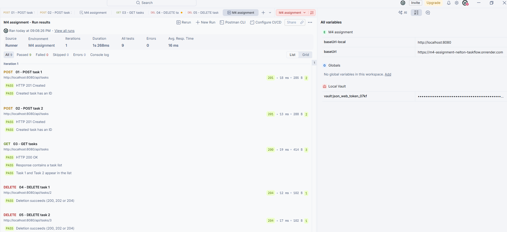
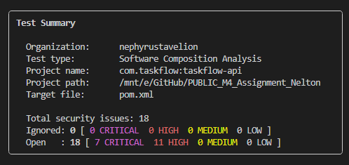
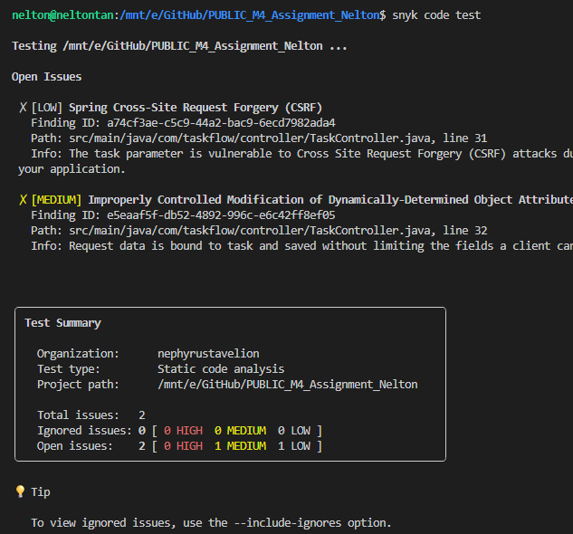
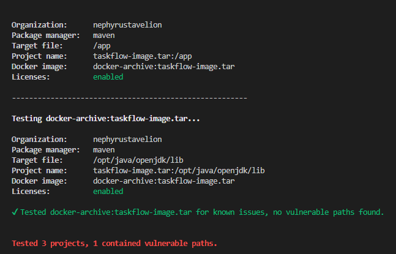

# TaskFlow API — Module 4: Dockerize & Deploy

**NTU PACE AI Engineering | Module 4 End-of-Module Assignment**  
Repository: [PUBLIC_M4_Assignment_Nelton](https://github.com/nephyrustavelion/PUBLIC_M4_Assignment_Nelton)

## 1. Project overview

This project continues the **TaskFlow REST API** developed in Module 3. The aim of Module 4 was to package the Spring Boot application as a Docker image, run it locally, and make the API accessible through a public deployment. I also explored CI/CD automation, image versioning, and DevSecOps security checks.

The assignment handout demonstrates deployment to **Railway**. I used **Render** as my hosting platform instead; the Dockerization and verification objectives remain the same, but this is a deviation from the handout's specified platform.

| Resource | Link |
| --- | --- |
| Live API — list tasks | [Render: `/api/tasks`](https://m4-assignment-nelton-taskflow.onrender.com/api/tasks) |
| Docker images and tags | [Docker Hub — `nephyrustavelion/taskflow`](https://hub.docker.com/repository/docker/nephyrustavelion/taskflow/tags) |
| CI workflow history | [GitHub Actions](https://github.com/nephyrustavelion/PUBLIC_M4_Assignment_Nelton/actions) |
| Earlier successful CI run | [Successful version-tag workflow](https://github.com/nephyrustavelion/PUBLIC_M4_Assignment_Nelton/actions/runs/42382199478) |

**Technology used:** Java 21, Spring Boot 4.x, Maven, H2, Docker, Docker Compose, GitHub Actions, Docker Hub, Render, Postman, Snyk, Dependabot, and OWASP ZAP.

## 2. Mandatory tasks — implementation walkthrough

### Task 1 — Create a Dockerfile

I used a **multi-stage Docker build**:

1. The **build stage** uses a Maven/Java 21 image to download dependencies, compile the source, and produce an executable JAR.
2. The **runtime stage** uses a smaller Java runtime image and copies the built JAR, avoiding Maven and build tools in the final image.

The source-controlled file is currently named `dockerfile` (lowercase), so the commands below specify it explicitly.

```bash
docker build -f dockerfile -t taskflow:local .
```

**Learning takeaway:** A JAR (Java ARchive) packages Java application components. A Spring Boot executable JAR normally contains the application classes, dependencies, configuration, and Boot launcher, allowing it to run with `java -jar app.jar`.

In the Docker build, `-DskipTests` skips **executing** unit tests while normally still compiling test sources. Automated tests run separately in CI.

### Task 2 — Build and test locally

After building the image, run the service and check its REST endpoint:

```bash
docker run --rm -p 8080:8080 taskflow:local
# In a second terminal:
curl http://localhost:8080/api/tasks
```

Alternatively, use the application's Compose service:

```bash
docker compose up --build app
```

The application was also exercised through **Postman** using both the local URL and the deployed Render URL (see Task 4).

### Task 3 — Deploy the API

I deployed the TaskFlow backend on **Render** and tested the public endpoint:

**https://m4-assignment-nelton-taskflow.onrender.com/api/tasks**

The Docker image is published to Docker Hub. 

**https://hub.docker.com/r/nephyrustavelion/taskflow/tags**

The GitHub Actions workflow builds and publishes images; Render hosting is a separate concern. The repository's current `ci.yml` does **not** include an explicit Render deployment job, so a successful CI run alone should not be taken as evidence of a completed automatic Render redeployment.

### Task 4 — Verify the deployed API

I tested task creation, retrieval, and deletion through Postman against:

- **Local:** `http://localhost:8080`
- **Deployed:** `https://m4-assignment-nelton-taskflow.onrender.com`

| Sequence | HTTP method | Endpoint | Expected outcome |
| --- | --- | --- | --- |
| 1 | POST | `/api/tasks` | Create task 1 (`201 Created`) |
| 2 | POST | `/api/tasks` | Create task 2 (`201 Created`) |
| 3 | GET | `/api/tasks` | Retrieve the tasks (`200 OK`) |
| 4 | DELETE | `/api/tasks/{task1Id}` | Delete task 1 (successful delete response) |
| 5 | DELETE | `/api/tasks/{task2Id}` | Delete task 2 (successful delete response) |

The created IDs are captured and reused for the DELETE requests, rather than assuming fixed IDs. The test sequence checks the main CRUD workflow; the exact status codes and response data should be confirmed from the Postman results.




## 3. Optional stretch goals

| Option | Assignment extension | My approach |
| --- | --- | --- |
| **1** | Add a CI pipeline | Implemented GitHub Actions for build, tests, security checks, and Docker image publishing; publication depends on successful checks. |
| **2** | Add a frontend on Netlify | Not attempted. However, used sprintboot's static to visualise test API endpoints |
| **3** | Use Simple CRM backend/frontend | Not attempted; retained TaskFlow. |
| **4** | Publish versioned Docker images | Used Git tags and Docker metadata to generate versioned and commit-based tags. |
| **5** | Add security checks | Explored Snyk SCA/SAST, container scanning, Dependabot, and OWASP ZAP. The handout specifically names **OWASP Dependency-Check**; that exact scanner was not added. |

### Option 1 — GitHub Actions CI pipeline

Workflow: [`.github/workflows/ci.yml`](.github/workflows/ci.yml)

The workflow is triggered by pushes to `main` and version tags matching `v*.*.*`. Its dependency chain is:

```text
Code push / version tag
         |
         v
  BUILD (Maven package, skip tests)
         |
         v
  TEST (Maven unit tests + test report artifact)
         |
         v
  SECURITY (Snyk dependency scan + Snyk Code)
         |
         v
  PUBLISH (Docker Buildx -> Docker Hub)
```

Each job has a different purpose:

- **Build:** packages the application using Java 21 and Maven.
- **Test:** executes automated tests and uploads Surefire reports.
- **Security:** checks known vulnerabilities in dependencies (**SCA**) and possible problems in Java source code (**SAST**). It is intended to stop publishing when high-severity findings are detected.
- **Publish:** logs in to Docker Hub using GitHub Secrets, creates image tags with `docker/metadata-action`, and builds/pushes the Docker image with `docker/build-push-action`.

**Security note:** Tokens must come from **GitHub Actions secrets**, not a committed `.env` file. The current repository's `ci.yml` still uses `env.SNYK_TOKEN`; this needs to be changed to `secrets.SNYK_TOKEN` (and the GitHub secret configured) for reliable CI authentication.

### Option 4 — Versioned Docker images

Two release tags have been used: **`v0.1.0`** and **`v0.1.1`**. The workflow's Docker metadata rules distinguish:

- **Version tags:** `v0.1.1` produces a Docker tag such as `0.1.1` (without the leading `v`).
- **Branch builds:** generate a short commit-based tag, for example `sha-abc1234`, to identify the source commit.
- **`latest`:** a moving alias, configured by `latest=auto` for eligible releases; it is not an immutable version.

Example of how a release tag is created and pushed:

```bash
git switch main
git pull --ff-only
git tag -a v0.1.2 -m "TaskFlow patch release"
git push origin v0.1.2
```

**Learning takeaway:** Git tags identify source-code commits; Docker tags identify built container images. Semantic Versioning uses **MAJOR.MINOR.PATCH** to communicate breaking changes, features, and fixes.

### Option 5 — Security and DevSecOps

I implemented security scanning using **Snyk**, **Dependabot**, and **OWASP ZAP** to identify vulnerabilities before and after deployment. I also added a security profile in [`compose.yaml`](compose.yaml) to run Snyk scans locally in an isolated Docker container.

**A. SCA — Scan Maven Dependencies**

```bash
docker compose --profile security run --rm --no-deps snyk
```

My initial Snyk scan analysed **80 dependencies and identified 18 vulnerabilities (7 Critical, 11 High)**, mainly involving transitive dependencies such as Apache Tomcat, Jackson, and JAXB.

To address these findings, I investigated upgrades to **Spring Boot 4.1.2, Jackson 3.1.8, and Logback**. This demonstrated how upgrading a parent dependency can resolve vulnerabilities across multiple indirectly managed libraries. The final resolved versions and remaining findings require verification after the changes.



**B. SAST — Scan Java Source Code**

```bash
docker compose --profile security run --rm --no-deps snyk \
  snyk code test --severity-threshold=high
```

Unlike SCA, SAST examines **my own Java source code** for potentially insecure patterns. Snyk Code identified **2 issues in `TaskController.java`**:

- **Low — Cross-Site Request Forgery (CSRF):** Requires reviewing authentication and CSRF protection.
- **Medium — Improperly Controlled Modification of Object Attributes:** Could be addressed by using DTOs to restrict which task fields clients can modify.

Both findings remain under review and have not yet been confirmed as remediated.



**C. Container Scan — Scan the Docker Image**

```bash
docker compose build app
docker save taskflow:local -o taskflow-image.tar
docker compose --profile security run --rm --no-deps snyk \
  snyk container test docker-archive:taskflow-image.tar \
  --file=dockerfile --severity-threshold=high
```

Container scanning checks the built Docker image for vulnerabilities, including operating-system packages that Maven dependency scanning may not detect. The generated `.tar` archive is excluded from Git.



**D. Dependabot and OWASP ZAP**

- [**Dependabot**](.github/dependabot.yml) checks GitHub Actions dependencies weekly and can propose updates through pull requests.
- [**OWASP ZAP**](.github/workflows/zap-baseline.yml) performs Dynamic Application Security Testing (DAST) against the deployed application. It is configured for manual execution and every Monday at 10:00 SGT, with scan alerts set to non-blocking.

**E. Vulnerability Management — `.snyk` Policy**

Not all vulnerabilities can be fixed immediately. I used the [`.snyk`](.snyk) policy file to document temporary exceptions for **one HIGH-severity JAXB XXE finding and two MEDIUM-severity Logback directory traversal findings**.

Each exception includes a reason and an expiry date of **31 December 2026**, allowing time to review the risk and apply a suitable upgrade.

I learned that **ignoring a vulnerability does not fix it**. The security risk remains and must be reassessed before the exception expires.

Overall, this exercise reinforced the **shift-left security** principle: automated security checks help detect vulnerabilities early, while proper remediation and documented risk acceptance prevent unresolved findings from being overlooked.

## 4. Build and CI optimizations — what I learned

### Maven dependency layer caching in Docker

The Docker build copies `pom.xml` before the source code and runs:

```dockerfile
COPY pom.xml .
RUN mvn -B dependency:go-offline
COPY src ./src
```

Because the dependency-resolution layer comes **before** source code is copied, Docker can often reuse that layer when application code changes but `pom.xml` does not. This can reduce repeated downloads; it does not eliminate the compilation step.

### Maven cache in GitHub Actions

```yaml
- uses: actions/setup-java@v6
  with:
    distribution: temurin
    java-version: "21"
    cache: maven
```

A GitHub-hosted runner normally starts fresh. The first successful cache population stores downloaded Maven packages; later runs may restore them and avoid downloading unchanged dependencies again. Compilation and testing still execute.

```text
First run:       cache miss -> download dependencies -> build/test -> save cache
Subsequent run: cache hit  -> restore dependencies  -> build/test
```

### Docker Buildx layer caching in GitHub Actions

```yaml
cache-from: type=gha,scope=taskflow
cache-to: type=gha,scope=taskflow,mode=max
```

These settings reuse **Docker build layers** through the GitHub Actions cache backend. This is **different from Maven caching**: one caches Docker image layers, while the other caches Maven dependency downloads.

### GitHub workflow variables and commands

| Expression or command | Meaning |
| --- | --- |
| `GITHUB_REF_TYPE` | Whether the workflow ref is a `branch` or `tag`. |
| `GITHUB_REF_NAME` | Name of the triggering branch or tag. |
| `${GITHUB_REF_NAME#v}` | Shell parameter expansion removing a leading `v`, e.g. `v0.1.1` → `0.1.1`. |
| `${GITHUB_SHA::7}` | Bash expansion returning the first seven characters of a commit SHA. |
| `docker build -t name:tag .` | Build and tag a local image. |
| `docker push name:tag` | Push an image to a container registry. |

The current workflow uses Docker's **metadata and build-push actions** instead of writing manual `docker build` and `docker push` shell commands.

## 5. Problems encountered and remaining verification

The assignment encourages documenting errors and what was learned from them. My troubleshooting included:

- **Maven Wrapper:** Snyk initially failed because `.mvn/wrapper/maven-wrapper.properties` was missing; I investigated the wrapper and the `--maven-skip-wrapper` option.
- **Snyk authentication:** A local `.env` does not automatically provide secrets to GitHub Actions; the CI job must explicitly receive the `SNYK_TOKEN` GitHub secret.
- **Large Git commit:** A generated `taskflow-image.tar` exceeded GitHub's 100 MB per-file limit. Image archives and secrets belong outside Git history.
- **Security findings:** A successful compilation does not mean dependencies or source code are vulnerability-free. Findings require upgrades, verification, or documented risk acceptance.

**Before final submission:** verify a fresh green `main` workflow, update the committed `pom.xml` if local security upgrades have not been pushed, ensure the Snyk secret is configured, confirm the Render deployment is running the intended image, and add the Postman/Snyk screenshots cited above. The current repository also has a Dockerfile port/command inconsistency to review: the Compose mapping uses container port `8080`, while `dockerfile` says `EXPOSE 8081` and specifies both `ENTRYPOINT` and a duplicate Java `CMD`.

## 6. Summary of learning

This assignment helped me connect the full lifecycle: **Java source → Maven build → executable JAR → Docker image → local testing → CI security gates → container registry → hosted API → API verification**. I also learned why reproducible environments, dependency and Docker caches, tagged releases, secret management, and separate SCA/SAST/DAST checks matter in a delivery workflow.

---

